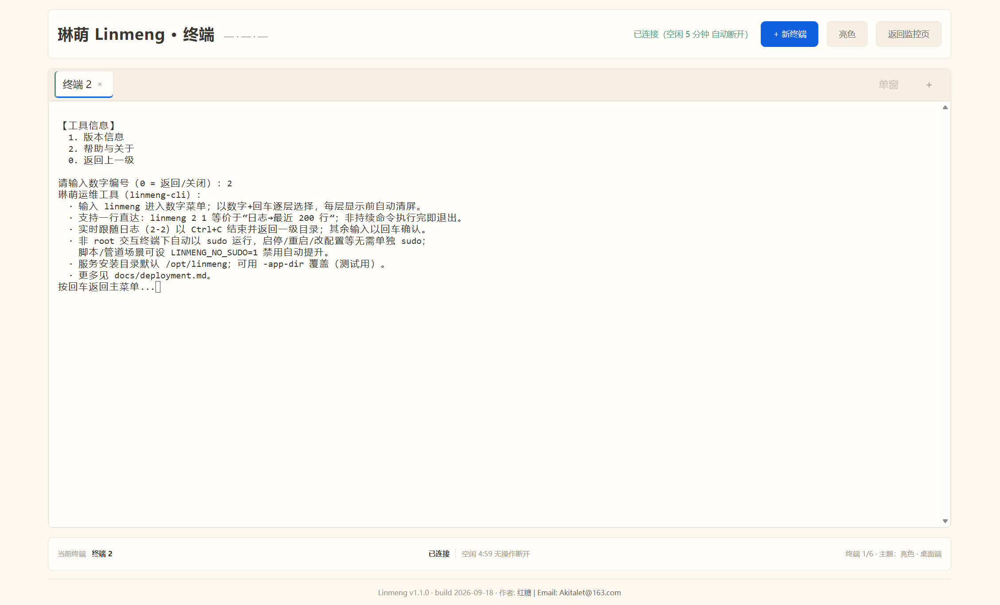

# 琳萌（Linmeng）· 局域网下Linux系统监视与 Web 终端

> **v1.3.1** ｜ Go 单二进制 ｜ 默认 `https://<主机>:8002`

琳萌（linmeng）是一个跑在目标主机本机的轻量服务，很适合 agent 直接操作；它做两件同等重要的事：

- **监测**——浏览器打开就能实时看到这台机器的系统运行状态：主机与系统信息、CPU、内存、磁盘、网络、GPU、任务与文件描述符，配短期曲线看趋势。这是项目本体的定位：一个局域网内的 Linux 系统信息监视器。
- **Shell**——同一个页面里还能开一个**真实 PTY shell**，以指定的低权用户身份运行。看到"内存涨了"可以直接进去查，不必再切到 SSH。

> **对自动化 agent 而言，shell 是最顺手的操作面**（与监测并列的两条主线之一）：一条长连接 + 标准输入输出流就能完成"执行命令 → 读输出 → 再决策"的闭环，不必为每种运维操作等一个新接口；权限、并发、寿命、审计都由服务端涵盖。展开见 [2.3](#23-为什么它特别适合-agent-操作)。

此外附带一条**文件传输**通道：把本地文件分片直传到主机落点目录，省掉临时起 sftp 的麻烦。

单进程、单二进制、无数据库、无外部服务依赖（第三方库只有 gopsutil 与终端两件套，全部静态编译进二进制）；前端内嵌其中，纯局域网使用，默认监听 `0.0.0.0:8002`。

| 能力 | 权重 | 一句话 |
| --- | --- | --- |
| 系统监测 | **主线** | 后台采样缓存 + 前端轮询，指标卡与短期曲线，秒开 |
| Web Terminal | **主线** | 浏览器内真 shell，也是 agent 最顺手的操作面；二次鉴权 + 一次性令牌 + 四道护栏 |
| 文件传输 | 附带 | 分片上传、摘要校验、不覆盖落盘；可开启双向下载 |
| 运维 CLI | 附带 | `linmeng` 数字菜单，封装 systemctl / 日志 / 配置 / 回滚 |

---

## 一、系统监测

### 1.1 数据怎么来的

后端按 `refresh_interval_seconds`（默认 2 秒，可调 1–5）在后台循环采集，把最新快照放在内存并覆盖写一份 `linmeng-cache/snapshot.json`；`GET /api/system/info` 只读缓存、**即时返回**，不阻塞在采集上。进程重启后会先载入上次的缓存文件，所以页面进入就有数据，不会先白屏几秒。

前端按同一节奏轮询，更新指标卡并把新点追加到曲线缓冲（保留最近 `history_points` 个点，默认 4，可调 2–60）。所有数据都是"当前状态 + 极短历史"：**没有数据库、不落历史、不做告警与推送**。

### 1.2 指标覆盖

| 模块 | 指标 |
| --- | --- |
| 系统信息 | 主机名、发行版、内核版本、运行时长、局域网 IP（首个非回环网卡） |
| CPU | 总使用率、逐核使用率、负载均值（1/5/15 min）、当前核心频率、**封装温度**与其临界值 |
| 内存 | 总量 / 可用 / 已用 / 使用率、buffer / cache、交换分区 |
| 磁盘 | 逐物理盘：IO 占用率、读写吞吐、读写 IOPS；**根盘**另有容量与 inode 占用 |
| 网络 | 逐物理网卡：累计收发、上下行速率、丢包与错误；TCP 已建连（全机聚合） |
| 任务 / 句柄 | 可调度任务数（含线程，取 `/proc/loadavg`）、文件描述符占用与上限 |
| GPU | 名称、数量、平均与逐卡使用率（尽力而为，无统一数据源时为空） |

模块粒度可开关：`enable_cpu/memory/disk/network/host/gpu/proc/fs` 八个布尔，关掉的模块在快照里返回 `null`（前端隐藏该模块，schema 不变），在页面「修改配置」里改完**立即生效**并回写 `setting.json`，不必重启。同处还能调刷新间隔（1–5 秒）与曲线点数（2–60）。

### 1.3 读数的口径（先对齐再比对）

- **内存**：`memory.used = MemTotal − MemFree − Buffers − (Cached + SReclaimable)`，与 `free` 的 used 同口径；比 GNOME 系统监视器（`总 − MemAvailable`）低 6~8 个百分点。要"可用"语义直接用 `memory.available`。
- **CPU**：`1 − idle/total`，**iowait / steal / irq 计入忙碌**，因此比把 iowait 单列的工具偏高约一个 iowait 占比。
- **任务数**：`proc.total/running` 是含线程的可调度任务数（对应 `ps -eL`），不是进程数。
- **磁盘**：空间与 inode 只对根盘采集（根盘固定排首位），其余盘只报 IO——不虚报无法合并的分区数据。
- **冷启动**：差分类字段（CPU%、网速、磁盘 IO / 吞吐 / IOPS）在服务启动后的第一个周期为 `0`，表示"还没基线"，不是"真的没流量"。
- **可空**：GPU、CPU 当前频率、封装温度、磁盘 IO 类字段在数据源不可得时返回 `null`（字段占位或模块隐藏）；`proc`/`fs` 在非 Linux 上整模块为空。这些都不影响整体运行，也不会让接口报错。
- **单位**：硬盘容量走 1024 进制标 `GiB`，其余容量/流量/速率一律 1000 进制标 `GB`、`MB/s`，方便与常见工具直接比对。

---

## 二、Web Terminal

### 2.1 它是什么

浏览器页面里跑的是 xterm.js（5.5.0，已内嵌，不依赖 CDN），后端用 `creack/pty` 在服务端拉起真实 shell，双向桥接 WebSocket。所以看到的就是这台机器上的 bash：`top`、`vim`、`tmux`、交互式程序、Ctrl+C / Ctrl+D、彩色输出、窗口缩放全部可用——和在 SSH 里没有区别，只是不用装客户端、也不用额外开 22 端口。

shell 以 `setting.json` 的 `shell_user` 身份运行（**必须是存在的非 root 用户**），这是这个功能的安全基线：网页是入口，特权不跟着网页走。

### 2.2 三步握手

终端不信任"已登录"这件事，凡开 shell 都要再验一次密码：

```text
① POST /api/auth/login          {"password":"…"}    → 200 + Set-Cookie: session_id
② POST /api/terminal/token      {"password":"…"}    → {"token":"<64位hex>","expires_in":900}
③ GET  /api/terminal/ws（WSS）  Sec-WebSocket-Protocol: linmeng.terminal, <token>
                                                    → 101，PTY 就绪
```

- 令牌由 `crypto/rand` 生成 32 字节（64 位 hex），**绑定当前会话、单次消费、默认 900 秒**；同一会话重新签发会覆盖旧的。刷新页面后旧令牌即作废，必须重新输密码。
- 密码错误与"未登录"返回同一个 `401`，不区分二者，避免被用来探测口令。
- 握手除令牌外还校验 **Origin**：`ws_allowed_origins` 为空时只允许同源，跨源访问需显式加白名单（精确匹配，不做通配）。
- 信道全程 `wss://`（v1.3.0 起默认 TLS），口令、键盘输入与终端输出都不再以明文过局域网。

### 2.3 为什么它特别适合 agent 操作

一句话：agent 要的是"能执行任意命令的通用接口"，而不是为每种操作等一个新端点。这个 shell 恰好长成了那种形态。

| 维度 | 具体表现 |
| --- | --- |
| 接口形态 | 一条长连接 + 扁平 JSON 文本帧（`input{text}` / `output{text}`），无嵌套 payload、无二进制帧；任意语言的 WebSocket 客户端十几行就能驱动 |
| 语义闭环 | 发命令 → 读 `output` → 用哨兵串（`echo __DONE_$?__`）判定结束并取退出码，等价于本地 `subprocess`，不需要为"查看磁盘""重启服务""查日志"分别对接三个 API |
| 能力随机器扩展 | 目标机上有什么命令就能用什么（`systemctl`、`journalctl -f`、`df`、`ss`、`apt`…），agent 的可用操作面不取决于服务端补了多少接口 |
| 失败可判定 | 握手阶段 `401/403/404/429` 语义固定；连上后 `4001` 重换令牌、`4002` 重连、`4003` 重登、`4006` 寿命到点重开、`1013` 退避——每种都有明确处置，不必猜 |
| 授权是一次性的 | 二次密码 + 一次性令牌（900 s、单次消费、绑会话）+ Origin 校验：授权范围是"一个会话、一次任务"，不会给 agent 留下永久后门 |
| 权限有边界 | shell 以 `shell_user`（非 root）运行，agent 拿不到 root，破坏面被限制在该用户可及的范围 |
| 不额外开口子 | 与浏览器共用同一条 8002 通道，目标机不必装 agent 守护进程、不必装 SSH 客户端、不必再开 22 端口 |
| 可对账 | 每次终端创建/关闭都写审计日志（时间、`session_id`、来源 IP），事后能还原"谁在什么时候开了 shell" |

三条配合要点（踩了会很痛）：

1. **长任务必须脱离 PTY**：`tmux new -d` / `nohup` / `setsid`。终端绝对寿命 2 小时且不可延长，前台挂着跑的一定被杀。
2. **一个 WS 就是一个 PTY，别在单会话里并发塞命令**：交互式程序会与后续命令抢 stdin；需要并行就开多个终端（上限 6）。
3. **输出是流式的、带 ANSI**：不要假设"一帧一条命令"，先剥控制序列，再用哨兵串切分结果。

> 换句话说：给 agent 一个 shell，等于把"执行任意命令"这一层能力交给它，而把"能做什么"留给机器的权限与管理员配置。这比穷举式地开放运维 API 更省事，也更接近人类运维的真实方式。

### 2.4 用起来是什么样

支持多标签与并排双终端（一边跑命令、一边盯日志）；网络抖动后点"重新连接"会重新走一次二次鉴权；窗口或分栏变化即时以 `resize` 帧同步尺寸，`vim`、`htop` 不错版。终端与仪表盘同站，切过去就能对照"这条命令执行后机器是什么反应"。

### 2.5 四道自动护栏

终端是唯一能执行任意命令的入口，写权限随之而来；因此默认带四道护栏，且都不能靠发帧绕开：

| 护栏 | 默认 | 行为 |
| --- | --- | --- |
| 并发上限 | 6（1–32） | 达上限的新握手直接 `429`，升级前原子预占名额，不会因并发握手双开 |
| 闲置断开 | 300 秒（30–86400） | 无输入、无 resize、也无 PTY 输出即断开（输出按 500 ms 节流计为活动，长任务刷屏不会被误杀） |
| 绝对寿命 | 7200 秒（600–43200） | 自建立起计时，到点强制回收；**不可延长**，任何帧只刷新闲置计时 |
| 背压队列 | 1024 帧 / 256 KB | 消费跟不上就断开（`1013`），不静默丢输出、不撑爆内存 |

另两条联动：**登出会连带关闭该会话下所有终端**（`4003`），**服务重启或停机则全部终端失效**（`1001`）；`1011` 则是 PTY 启动失败，多为 `shell_user` 或 shell 路径不对。

### 2.6 打开它需要做什么

1. `enable_terminal=true`（出厂默认，改后需重启；开关只认 `setting.json` 与运维 CLI，页面「修改配置」里没有它）；
2. 服务以 root 运行时，`shell_user` **不允许为空**，且必须是已存在的非 root 用户。不满足时终端整体按"不存在"处理（`/terminal` 与终端端点全部 404，仅日志留 WARN）；
3. 浏览器打开 `https://<主机>:8002/terminal`，输入密码 → 再输一次密码 → 得到 shell。

### 2.7 最小接入示例（脚本 / agent）

终端不绑定浏览器，任何能发 HTTP 与 WebSocket 的运行时都能用。要点只有两个：**令牌走子协议头**、**请求必须自带同源 `Origin`**（不带 Origin 一律 403，加白名单也救不了）。

```python
import json, ssl, requests, websocket

BASE, PWD = "https://<主机>:8002", "<访问密码>"
s = requests.Session(); s.verify = False                     # 自签证书
s.post(f"{BASE}/api/auth/login", json={"password": PWD}).raise_for_status()
tok = s.post(f"{BASE}/api/terminal/token", json={"password": PWD}).json()["token"]

ws = websocket.create_connection(
    BASE.replace("https://", "wss://") + "/api/terminal/ws",
    subprotocols=["linmeng.terminal", tok],
    cookie="; ".join(f"{k}={v}" for k, v in s.cookies.items()),
    origin=BASE,                                              # 必带
    sslopt={"cert_reqs": ssl.CERT_NONE},
)
ws.send(json.dumps({"type": "input", "text": "uname -a\n"}))
print(ws.recv())                                              # {"type":"output","text":"…"}
```

帧格式是扁平的 JSON 文本帧（无 payload 嵌套）：`input{text}` / `resize{cols,rows}` / `output{text}`（含 ANSI 转义）/ `ping` / `pong{remaining_idle_seconds}` / `exit{code}`。

---

## 三、文件传输

### 3.1 一次文件的生命周期

不想为传一个文件去配 sftp/sshd 时用它：浏览器选文件 → 前端切片并同时算出每片摘要与整文件摘要 → 逐片 `POST /api/transfer` → 服务端按偏移写同一个 `.part` → 收齐后按序回读校验、改名落盘。

```text
① POST /api/transfer/token   {"password":"…","count":N} → {"tokens":[…],"expires_in":900}
② POST /api/transfer         首片：令牌 + file_name / file_size / total_chunks / chunk_index / chunk_hash / file
                            → {transfer_id, received_bytes, algo, complete:false}
③ POST /api/transfer         第 2..N 片：transfer_id + chunk_index / chunk_hash / file（可乱序、可重传）
④ POST /api/transfer         末片：同上再带 hash（全文件摘要）→ {complete:true, saved_as, abs_path, size, algo, hash}
```

### 3.2 端点

| 操作 | 端点 |
| --- | --- |
| 换传输令牌（1–64 张，`count` 可省） | `POST /api/transfer/token` |
| 上传一个分片 | `POST /api/transfer`（multipart，首片带 `X-Linmeng-Transfer-Token`） |
| 查进度 / 取消 / 已完成记录 | `GET /api/transfer/status/{id}` / `DELETE /api/transfer/{id}` / `GET /api/transfer/list` |
| 列落点目录 | `GET /api/transfer/files`（回 `files` + `download_enabled`） |
| 下载单个文件 | `GET /api/transfer/files/{name}`（仅 `enable_web_download=true` 时注册） |

### 3.3 关键设计

- **分片与幂等**：默认 5 MiB 一片（`upload_chunk_bytes`），单请求体硬上限 5 MiB + 64 KiB；服务端按 `chunk_index × 分片大小` 偏移写，**乱序到达无需重排，重传同片幂等**。
- **令牌**：一次密码最多换 64 张、每张只够"开工"一个任务、单次消费、默认 900 秒；后续片凭 `transfer_id`（32 位 hex，不可猜）+ 会话归属放行，不必反复输密码。
- **校验**：算法由服务端按 `file_size` 唯一确定——`< 4 GiB` 用 MD5，`≥ 4 GiB` 用 SHA-256；片级不符报 `422`，全文件不符同样整单重传。
- **不覆盖**：同名冲突按 `stem_数字.ext` 另取名（收尾用 `Link` + `Remove`，不是会静默覆盖的 `rename`）。
- **去重**：同算法 + 同摘要的文件已存在时回 `409`，属特性，不必重传。
- **错误可续**：任务建好之后的 4xx/5xx 错误体都带 `transfer_id`——首片成功但本片被拒时令牌已消费，重走开工必 401，必须用它续传。
- **并发与回收**：同时进行的任务上限 3（1–8，满则 `429`）；后台每 60 秒扫一次，30 分钟无分片的任务作废并删 `.part`；已完成记录保留 256 条、逐条 24 小时、重启清空（只丢记录，不删已落盘文件）。
- **落点**：默认 `<shell_user 的 home>/linmeng_download`，推导失败即"未就绪"回 `503`，绝不回退去写 `/root`。

### 3.4 单向与双向

默认**单向**（`enable_web_download=false`）：只能上传、只能看到落点目录里的文件名。置 `true` 后可在网页端下载这些文件（支持 `Range` 断点续传）；关闭时下载端点**根本不注册**、回 404 属设计而非权限问题，任何模式下上传链路都不受影响。

与终端一致：上传走 `https://` 并校验 Origin；只读端点与换令牌端点不校验（浏览器同源 GET 不带该头）。

---

## 四、部署

前置：Linux + systemd（Debian/Ubuntu、Linux Mint 等），x86_64 或 arm64，单二进制静态编译，目标机无需 Go 环境。

```bash
# 1. 一键安装（幂等）：服务 → /opt/linmeng/linmeng，CLI → /usr/local/bin/linmeng
sudo bash install.sh                      # 发布包内二进制带版本名时：sudo bash install.sh linmeng_v1.3.1 linmeng-cli_v1.3.1

# 2. 必做：准备终端的低权运行用户（install.sh 不自动创建）
sudo useradd -r -s /bin/bash -m linmeng
linmeng 3 3                               # 配置管理 → 修改配置项：键 shell_user，值 linmeng
sudo systemctl restart linmeng            # 部署级键，改后必须重启

# 3. 验证
systemctl status linmeng --no-pager
curl -ik https://127.0.0.1:8002/login     # 自签证书，需 -k
linmeng 7 1                               # 查看服务与 CLI 版本
```

浏览器访问 `https://<主机局域网IP>:8002`，输入密码登录。访问密码缺省 `admin123`（存于 `/opt/linmeng/.env` 的 `AUTH_PASSWORD`），登录后可在页面「修改密码」改掉。

- **TLS 默认开启**（首启自签本地 CA + 叶子）：浏览器首次访问需导入根 CA 或一次性"接受风险"；用 `http://` 打 8002 会被 Go 直接回 400，属预期，不是服务没起。`enable_tls=false` 可退回明文。
- 端口 8002 为出厂默认；端口、终端、接收、TLS 都是部署级配置（改 `setting.json` 后重启），页面改不了。
- 手动安装、证书信任、卸载与回滚见 `linmeng/docs/deployment.md`。

---

## 五、运维 CLI

`linmeng`（独立二进制 `linmeng-cli`，装上即 `/usr/local/bin/linmeng`）把日常运维收成一个中文数字菜单，配置读写的口径与服务端一致：

```bash
linmeng            # 进入菜单
linmeng 1 4        # 重启服务
linmeng 2 1        # 最近 200 行日志
linmeng 3 3        # 修改配置项（含 shell_user 等部署级键）
linmeng 4 2        # 运行自检（登录页、401、登录后取快照、TLS 真校验）
linmeng 6 2        # 回滚到上一个二进制并重启
```

菜单覆盖服务生命周期、日志、配置、快照摘要、自检、防火墙放行与更新回滚；非 root 的交互终端会自动 `sudo` 重跑。

---

## 六、目录结构（简述）

```text
linmeng/
├── main.go                  # 入口
├── setting.json             # 32 键配置（与 install.sh 模板同源）
├── .env.example             # 机密配置模板（AUTH_PASSWORD）
├── install.sh               # 一键安装（服务 + CLI + 配置 + systemd）
├── cmd/linmeng-cli/         # 运维 CLI 入口
├── internal/                # config / collector / terminal / transfer / tlscert / origin / cli / http
└── web/static/              # 内嵌前端：仪表盘 / 终端页 / 接收页 / xterm 5.5.0
```

---

## 七、其他

1. **仅限局域网**：定位是内网临时监测与运维，安全措施没有那么严格，请不要做端口映射或公网暴露。
2. **关于终端**：`shell_user` 身份能写文件、管进程、连网络，按需开启（`enable_terminal=false`）即可。
3. **不做历史持久化**：曲线只存前端内存（`history_points` 个点），重启即清；不告警、不推送；桌面为主，窄屏仅基础适配。
4. 项目源于个人实际需求，也不算是一个很厉害的程序，我做总体架构，代码由 AI 生成、原始文档我手搓，说明文档ai润色，难免会出现有错误的地方；希望对你有所帮助。

---
<p align="center">
  
</p>
- v1.1.0 监控主页预览

---
<p align="center">
  
</p>
- v1.1.0 终端页面预览
